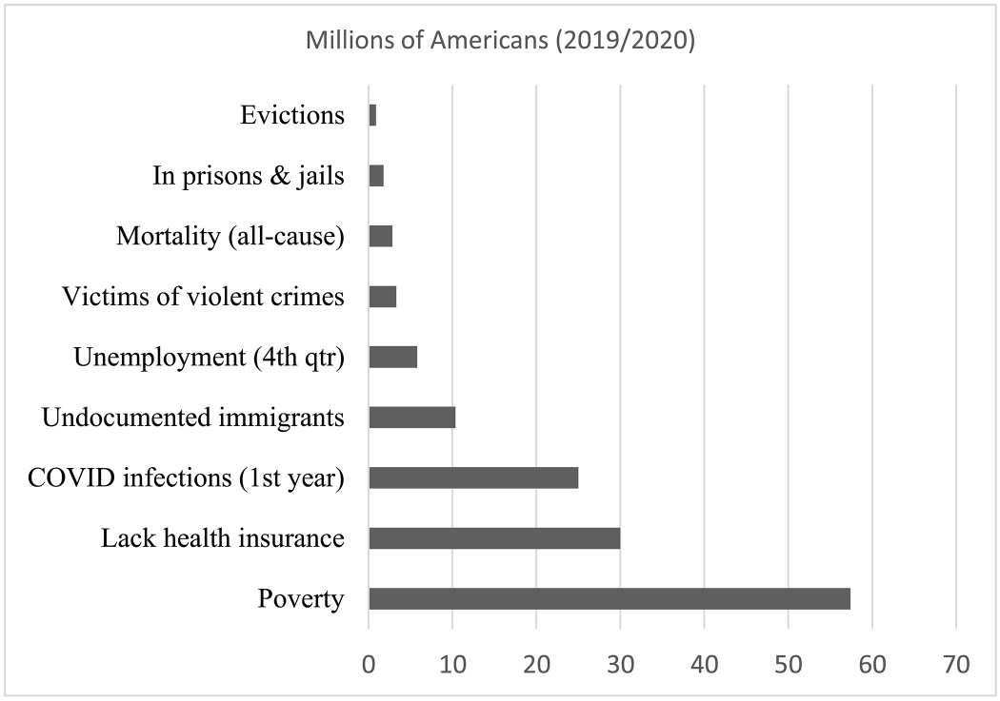
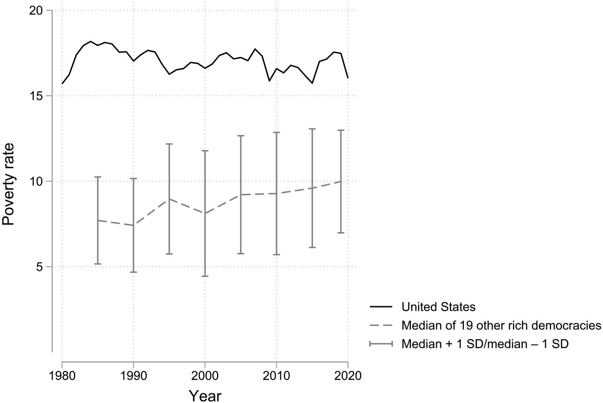
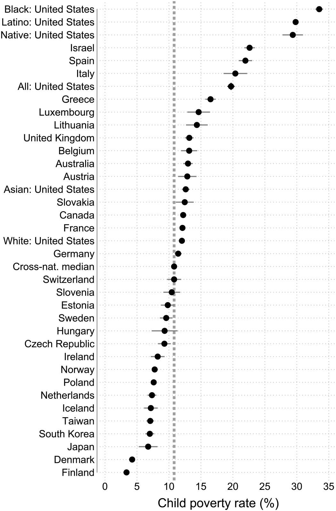
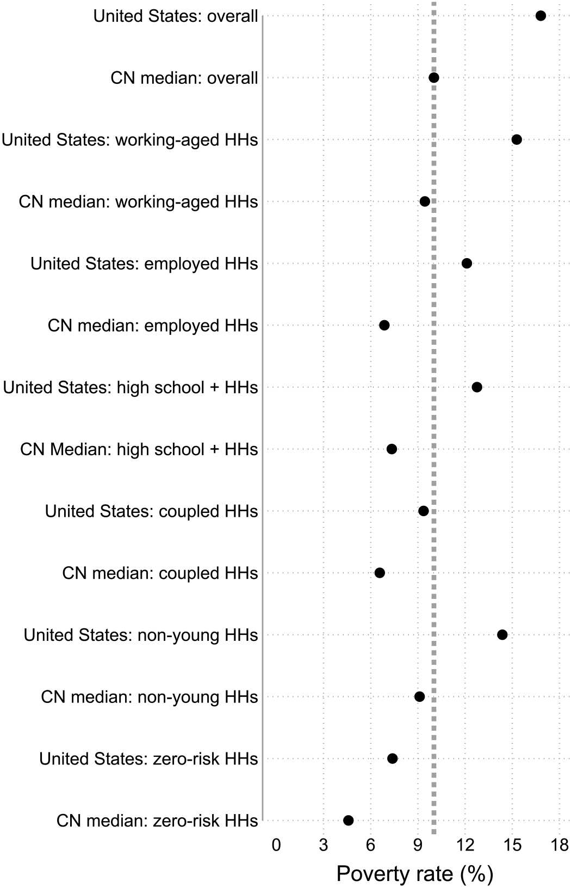
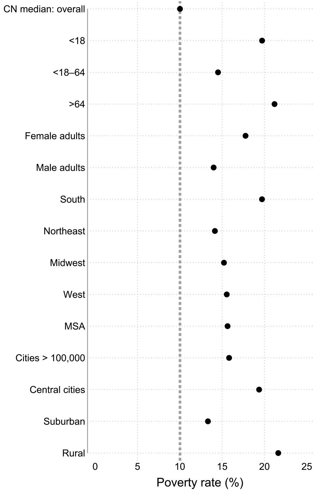
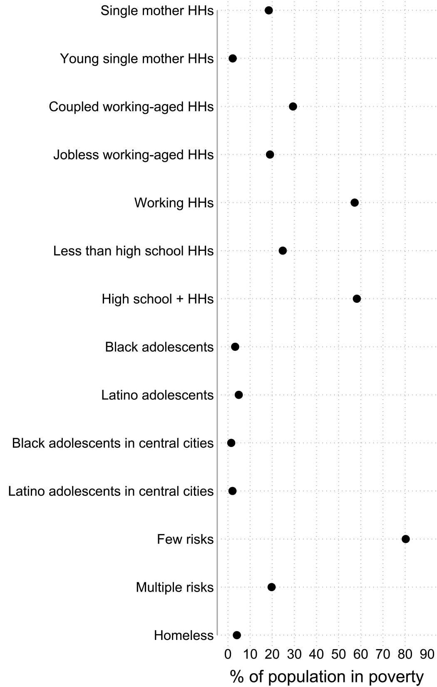
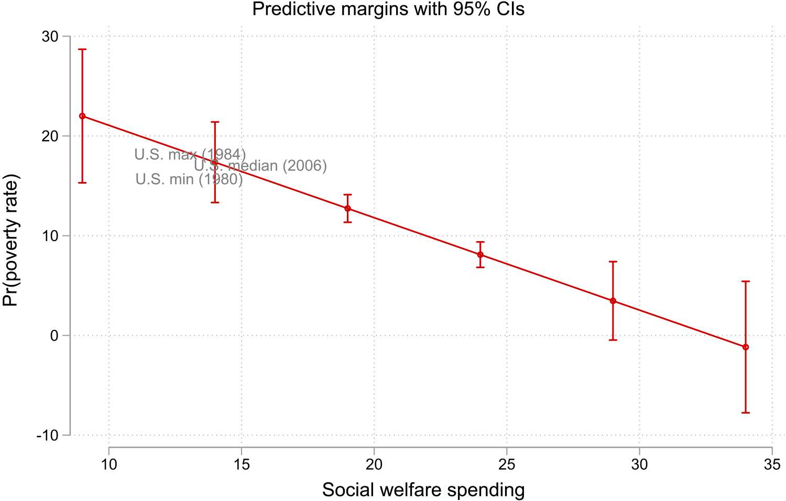
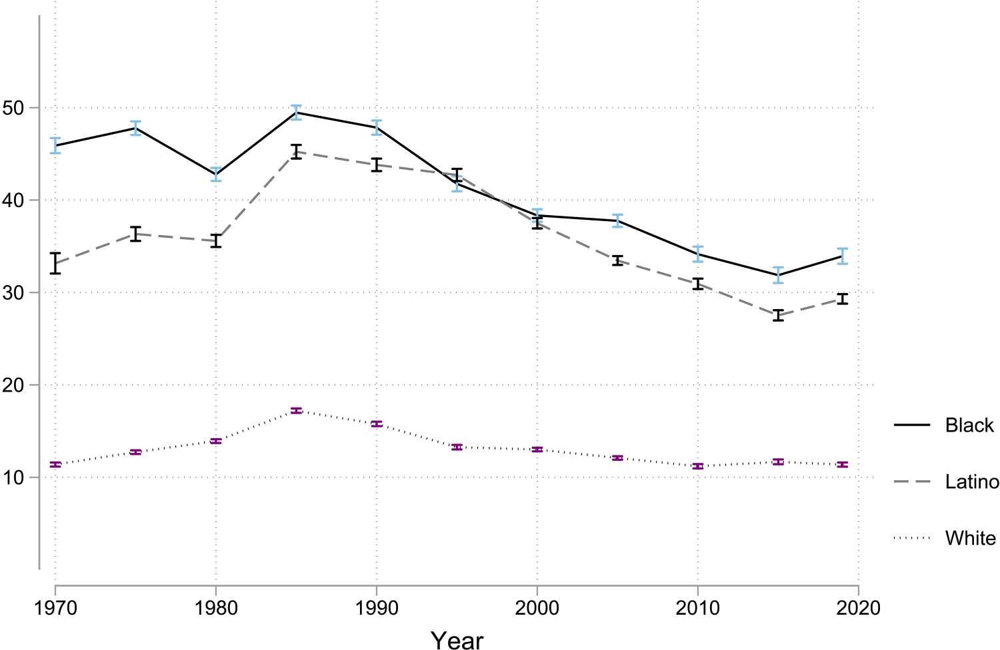
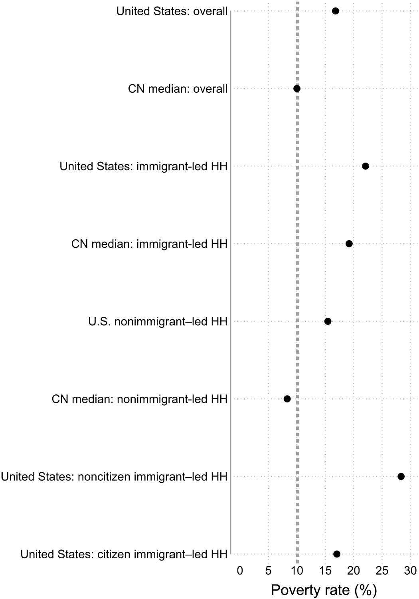

## {.big-center}

::: {.statement}
The field asks why **the poor** are poor.
:::

. . .

::: {.statement}
Brady asks why the United States has so much **poverty**. [@bradyPovertyNotPoor2023]
:::

::: {.notes}
- Review article by David Brady (UC Riverside, WZB Berlin), Science Advances 2023.
- Opens with Katz: "The idea that poverty is a problem of persons ... has dominated discussions of poverty for well over two hundred years and given us the enduring idea of the undeserving poor."
- The field routinely asks why the poor fail to get married, do not complete their education, do not work.
- Brady: this focus "has been incapable of providing an accurate understanding of that systemically high poverty." Needs a paradigm shift: poverty, not the poor.
:::

---

## Overview

::: {.fragment fragment-index=1}
1. The United States has systemically high poverty
:::

::: {.fragment fragment-index=2}
2. Three prevailing approaches, and why they fail
:::

::: {.fragment fragment-index=3}
3. Political explanations
:::

::: {.fragment fragment-index=4}
4. Discussion
:::

# 1. Systemically high poverty

## How poverty is measured here

. . .

- Relative measure: poor if household income is below 50% of the median

. . .

- Income after taxes, tax credits and transfers ("post-fisc"), equivalised by household size

. . .

- Data: Luxembourg Income Study (LIS), rich democracies, 1980 to 2020

::: {.notes}
- The official US poverty measure (OPM) is explicitly avoided: thresholds too low, based on a 1950s rule of thumb that food is a third of expenses, ignores taxes and tax credits, counts some transfers but not SNAP, housing subsidies, EITC, CTC. Two National Academy panels (1995, 2019) critiqued it.
- Relative measures "better predict well-being, health, and life chances" and are more reliable over time and across places.
- Equivalised: income divided by the square root of household members.
:::

---

## Five patterns

::: {.incremental}
- a huge share of the population
- a perennial outlier among rich democracies
- staggeringly high for certain groups
- unexpectedly high for those who "play by the rules"
- pervasive across groups and places
:::

::: {.notes}
- These five patterns are Brady's definition of "systemically high". One figure for each.
:::

---

## A huge share of the population

{.card fig-align="center" width="80%"}

::: {.notes}
- 2019: 17.5% of the US population, about 57.4 million people, were poor.
- Almost 64 times as many people in poverty as evicted. More than 32 times as many as incarcerated. 17 times the victims of violent crime. Almost 10 times the unemployed.
- Pew has never listed poverty among the biggest problems facing the nation.
- Poverty is also an event: about 45 to 46% of people in poverty are in their first year of being poor. About 61% of Americans experience at least one year of poverty in their lives.
:::

---

## A perennial outlier

{.card fig-align="center" width="85%"}

::: {.notes}
- Solid line: US, every year near its average of 17%. Dashed: median of 18 other rich democracies, average 8.8% over the period.
- "By far, the clearest 'trend' in American poverty is stability at a high level."
- Stability is not an artefact of the relative measure: Israel, Luxembourg, Sweden, UK show substantial change.
- Israel has had higher poverty than the US since 2005. Otherwise the typical rich democracy stays far below.
:::

---

## Staggeringly high for some groups

{.card fig-align="center" height="520"}

::: {.notes}
- Child poverty. Black children 33.5%, Latino children 29.8%, Native American children 29.4%.
- No rich democracy comes close: the next highest are Israel and Spain at about 22%, and none exceeded 26.1% in four decades of LIS data.
- White and Asian American children are close to the cross-national median of 10.8%. White child poverty is lower than in Canada and France.
- So the US overall rate is partly "simply due to staggeringly high poverty for ethno-racial minorities".
- Backup: Fig. 4, Black and Latino child poverty near 50% in the 1980s.
:::

---

## Unexpectedly high for those who "play by the rules"

{.card fig-align="center" height="520"}

::: {.notes}
- Non-risk groups among working-aged households, US versus the cross-national (CN) median of 31 rich democracies.
- Employed households: 12.1% in the US, above the CN median for the overall population (10%).
- Households led by a high school graduate: 12.8%. Non-young households (head 25+): 14.4%.
- Even people with zero risks: 7.4% are in poverty.
- And most Americans are not in the risk groups: 94.8% of working-aged households are employed, 91.2% led by someone with at least high school.
- More than three times as many people in working-poor households (9.7% of the population) as in jobless poor households (3.2%).
:::

---

## Pervasive across groups and places

{.card fig-align="center" height="520"}

::: {.notes}
- Highest among under 18s and over 64s, in the South, central cities and rural areas.
- But above the cross-national median among working-aged adults, among both women and men, in all four regions, in large cities, moderate cities and suburbs.
:::

# 2. Three prevailing approaches

## {.big-center}

::: {.statement}
(i) fixing the poor · (ii) dramatizing the poor · (iii) cultural explanations
:::

::: {.notes}
- Brady's own labels. All three focus on the individual poor rather than on why poverty is systemically high. He links this to America's uniquely strong individualistic ideology.
:::

## (i) Fixing the poor

Behavioural explanations: the poor are poor because they more often carry one of four risks

. . .

  joblessness · low education · young headship · single motherhood

. . .

Anti-poverty strategy: reduce the share of the population with these risks

::: {.notes}
- Behaviour is the mechanism, driven by choices and incentives, culture, traits. Hence the focus on welfare disincentives, on getting people to marry, finish school, work.
- Example named in the paper: Shah, Mullainathan and Shafir (2012, Science) simulate scarcity in lab games (Wheel of Fortune, Family Feud, Angry Birds) and conclude "the poor often behave in ways that reinforce poverty."
- Public version: Sawhill's "success sequence". AEI-Brookings consensus plans of 2015 and 2022: first recommendation is a new cultural norm around marriage.
:::

---

## (i) Fixing the poor: prevalences and penalties

. . .

**Prevalence**: the share of the population with a risk

**Penalty**: how much more likely a risk makes you to be poor

. . .

The US does not stand out on prevalences. It has the highest penalties of any rich democracy.

::: {.notes}
- Framework from Brady, Finnigan and Hübgen (2017). Three critiques of behavioural explanations:
- (1) Prevalences cannot explain macro variation. Across 29 rich democracies the US ranks 20th on the prevalence of at least one risk, below average on joblessness and low education. If the US had median prevalences, poverty would go up, not down. Risks have declined markedly since the 1970s while poverty stayed flat.
- (2) Causality is questionable. Risk coefficients are not causally identified, risks are endogenous to poverty. Penalties vary over time and across countries: in 16 of 29 rich democracies single motherhood does not even significantly predict working-aged poverty.
- (3) Behaviouralists study prevalences and neglect penalties, yet there is far more variation in penalties, and reducing penalties would reduce poverty more.
- "Who is poor" does not explain "why there is poverty".
- Studying only the US, an outlier on both poverty and penalties, biases impressions about how much risks matter. Smeeding: the US literature "rests on an inherently parochial foundation".
:::

---

## (ii) Dramatizing the poor

{.card fig-align="center" height="520"}

::: {.notes}
- Second approach: ethnography and intensive interviews that humanise the poor through vivid, often shocking narratives. Evicted, $2.00 a Day, On the Run, Gang Leader for a Day.
- Brady grants it is more construct valid than lab games, and it reveals the near-impossible choices people face.
- But three problems. (1) It overrepresents unrepresentative, "exotic" groups. Fig. 7: among people in poverty, 29.4% live in coupled working-aged households versus 18.5% in single-mother households, 57.2% in employed versus 19% in jobless households, 80.3% have zero or one risk. Black and Latino adolescents in inner cities are 1.4% and 2.3% of people in poverty. About 4% are homeless.
- The composite "typical" poor person: a white woman aged 35 to 45, high school education, coupled and employed household, no children, metropolitan area in the South.
- (2) It focuses on symptoms. Eviction: 64 times fewer people than in poverty, and "far more a symptom than a cause".
- (3) It downplays effective policy, the "fallacy of intractability". $2.00 a Day omits SNAP, which substantially reduces extreme poverty. Most people in extreme poverty are childless adults, and the biggest group of extremely poor children is in immigrant households.
- Misrepresenting the poor can backfire politically by feeding stereotypes.
:::

---

## (iii) Cultural explanations

. . .

Old version: a pathological culture causes behaviour that causes poverty

. . .

New version (2010): "frames", "scripts", "repertoires" cause behaviour that causes poverty

. . .

Same problems: endogeneity, no comparison groups, never tested against rival explanations

::: {.notes}
- Old culture-of-poverty work collapsed under logical and evidentiary problems, not just political controversy: endogenous (if culture causes poverty and poverty causes culture, what causes the high poverty in the first place?), selection on poor people and poor neighbourhoods, stereotypes from elite white male academics. Evidence long shows the poor do not hold anti-marriage or anti-school values.
- 2010: "'Culture of Poverty' Makes a Comeback" (NYT). Small, Harding and Lamont's Annals issue, among the most cited poverty research of recent decades.
- New vocabulary, same argument: "Rather than causing behavior, frames make it possible or likely." Brady: no real difference.
- Harding's Living the Drama: 60 Black and Latino boys in three poor Boston neighbourhoods, no comparison group, dismisses structural explanations as "feathers buffeted by winds".
- Rather than boys lacking soft skills, ample evidence of employer discrimination. Rather than ignorance about college, segregated lower-quality schools.
- Combines the weaknesses of fixing and dramatizing: cannot explain the high poverty that sets the stage, overrepresents stereotypical groups.
:::

# 3. Political explanations

## {.big-center}

::: {.statement}
Poverty is a problem of **distribution**, not scarcity.
:::

. . .

::: {.statement}
Power and institutions make policy. Policy makes poverty.
:::

::: {.notes}
- Rich democracies have abundant resources. Poverty exists because they are not well distributed, and distributions are shaped by politics.
- Rank's musical chairs: too few chairs (good jobs), not the players' quickness, explains who is left standing. Brady's version: not too few chairs, one person is lying across three, several are piled broken in a corner, and someone is told there is no seat because of a "scarcity".
- Distinction from "structural" explanations (deindustrialisation, labour markets): "structuralists view poverty as the unfortunate byproduct of contextual factors ... political accounts view poverty as the willfully chosen outcome of state (in)action when something could be done."
- Rather than risks causing poverty, policy and institutions moderate the link between risks and poverty.
- Rise of this literature after about 2000, enabled by LIS data. "Poverty scholars who only know one country, know no country."
:::

---

## Social policy generosity

{.card fig-align="center" width="85%"}

::: {.notes}
- "There has never been a country in the modern history of capitalist democracies that accomplished sustainably low poverty without a large welfare state."
- Fig. 8: two-way fixed-effects model (country, year), 20 rich democracies, 1980 to 2019, poverty on social welfare spending as a percent of GDP and its square.
- The actual US minimum (1980), median (2006) and maximum (1984) poverty rates fall almost exactly on the predicted line. The US is always in the upper left: high poverty, low spending.
- Holds whether generosity is measured as legislated social rights, transfers received, or total spending. Monetising Medicaid shows the ACA expansion reduced poverty.
- COVID: extended unemployment insurance, expanded Child Tax Credit and relief payments made poverty considerably lower.
- Implementation matters too: administrative burden, racial disparities in access.
:::

---

## Three more political themes

. . .

**Penalties are political choices.** Countries decide which risks to protect.

. . .

**Power resources.** Unions, Left parties, women in parliament push for generous policy.

. . .

**Institutions.** Slavery, segregation, federalism, criminal justice, citizenship law.

::: {.notes}
- Penalties: more than three times as much cross-national variation in single-motherhood penalties as in prevalences. The US does not have a high prevalence of single motherhood, it has the highest penalty. Not acting is a choice just like acting.
- Power resources: the default distribution of power in a capitalist democracy favours elites and business, so the less advantaged need to organise. Poverty is lower where Left parties govern, unionisation is higher, and women are a larger share of parliaments. VanHeuvelen and Brady (PSID 1976 to 2015): household union membership and state unionisation both reduce poverty and reinforce each other, spilling over to non-union households. Brady conjectures low unionisation is a more salient cause of poverty than eviction.
- Also: skepticism about the political theory behind dramatizing. No evidence that Americans are less compassionate, strong evidence they are uniquely individualistic, and no proof that poverty scholarship influences policy-makers.
- Institutions: path dependency, "residue of the power of collective actors in the past". Labour market institutions, minimum wages, citizenship rules. Immigrant-led households 22.1% poverty, noncitizen immigrant households 28.4% (Fig. 9 in backup). Baker and colleagues: nativity and citizenship explain the largest share of Latino-white and Asian-white poverty gaps.
- Racism: state-supported segregation (Massey and Denton). Baker's historical racial regimes in the South: Black poverty and the Black-white gap rise with a state's HRR score, white poverty does not. Political explanations put racism at the centre, the three prevailing approaches barely mention it (Small et al. one mention, Harding one index entry).
:::

# Conclusion

## {.big-center}

. . .

US poverty is high, stable, and everywhere

. . .

Explanations that start from the individual poor cannot account for it

. . .

Explanations that start from power, policy and institutions can

::: {.notes}
- Brady is "far from the first to criticize the individualistic problem of persons". What he documents is the empirical ascendance of political explanations, mostly since 2000 and mostly through cross-national data.
- The claim at the end: political explanations are more likely to lead to effective policy.
:::

# 4. Discussion

## Discussion points

::: {.incremental}
- Scarcity-mindset research is the paper's archetype of "fixing the poor". Fair? What would a behavioural science of *poverty* rather than *the poor* look like?

- "Who is poor" is not "why is there poverty". Where does our own work answer the first question and present it as the second?

- A single-country literature on an outlier. The same logic as the WEIRD critique, turned on US poverty research. Where are we in the same position?

- Brady's evidence is cross-national and observational. He faults behavioural work for weak causal identification. Does he meet his own standard?

- "It has never really been proven that poverty scholarship ... has much influence on policy-makers or public opinion." That is a testable psychological claim.
:::

::: {.notes}
- Shah, Mullainathan and Shafir (2012) are named explicitly, as are Bertrand, Mullainathan and Shafir (2004) and Gennetian and Shafir (2015). Brady's objection is construct validity (video games as scarcity) and that the feedback-loop story cannot explain why the US has high poverty in the first place.
- Type III error: "the right answer for the wrong question" (Schwartz and Carpenter 1999 is cited for this).
- Henrich, Heine and Norenzayan (2010) is in Brady's reference list, cited for American individualism.
- On causality: Fig. 8 is a fixed-effects regression on spending. Brady argues the external validity of a pattern replicated across many samples outweighs the internal validity of any one local effect. Worth discussing whether that is persuasive.
- Last point connects to intervention research: if penalties are set politically, what is the role of individual-level interventions? Analogy to our megastudy, where interventions move an attitude but not the downstream outcomes.
:::

## References

::: {#refs}
:::

# Backup

## Child poverty over time

{.card fig-align="center" width="85%"}

::: {.notes}
- Black child poverty near 50% and Latino child poverty above 45% in the mid-1980s, an increase from the 1970s. Only recently down to near 30%.
- "Most Black and Latino adults today grew up experiencing truly extraordinarily high poverty during childhood compared to any rich democracy in over four decades of the LIS."
:::

---

## Immigrant and citizenship status

{.card fig-align="center" height="520"}

::: {.notes}
- Immigrant-led households in the US: 22.1%. Citizen immigrant households similar to the overall population. Noncitizen immigrant households: 28.4%.
- Citizenship laws and their enforcement block access to social policy, constrain employment rights, and limit residential choices. Immigrants may be "the most understudied population in poverty in the United States".
:::
